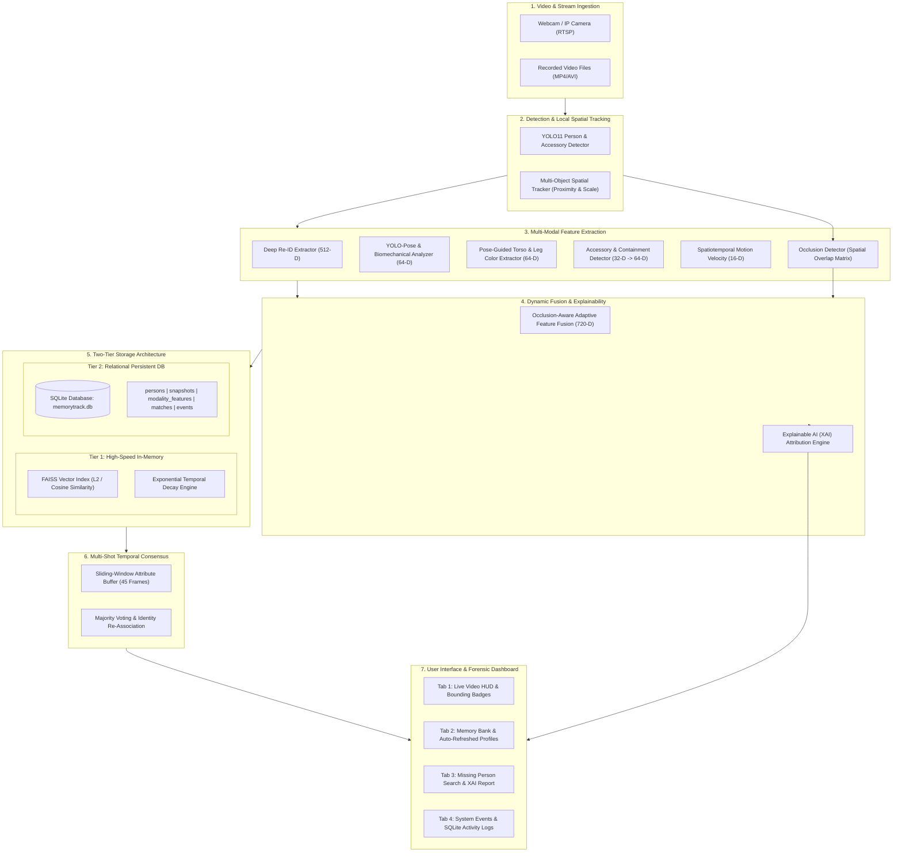
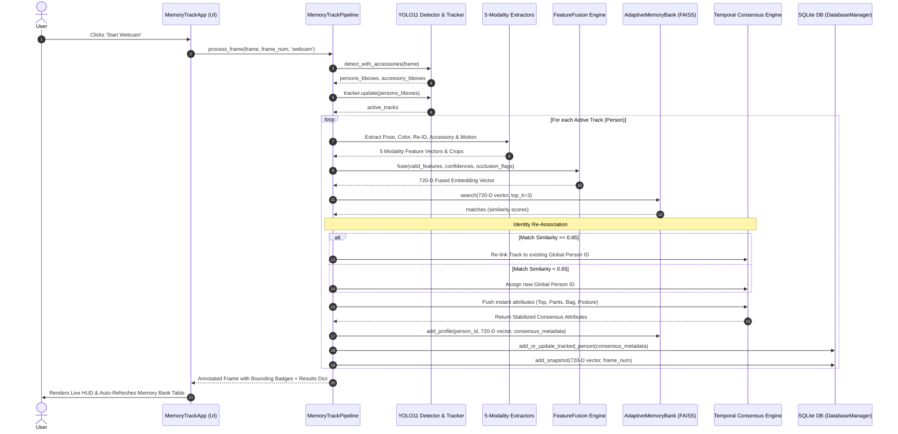
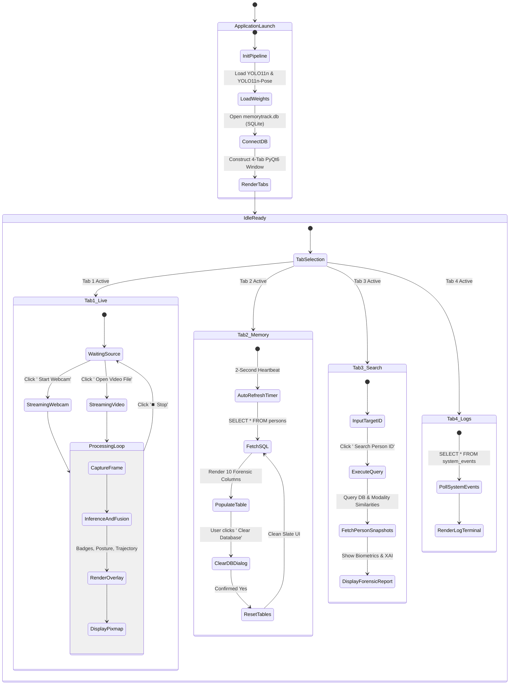
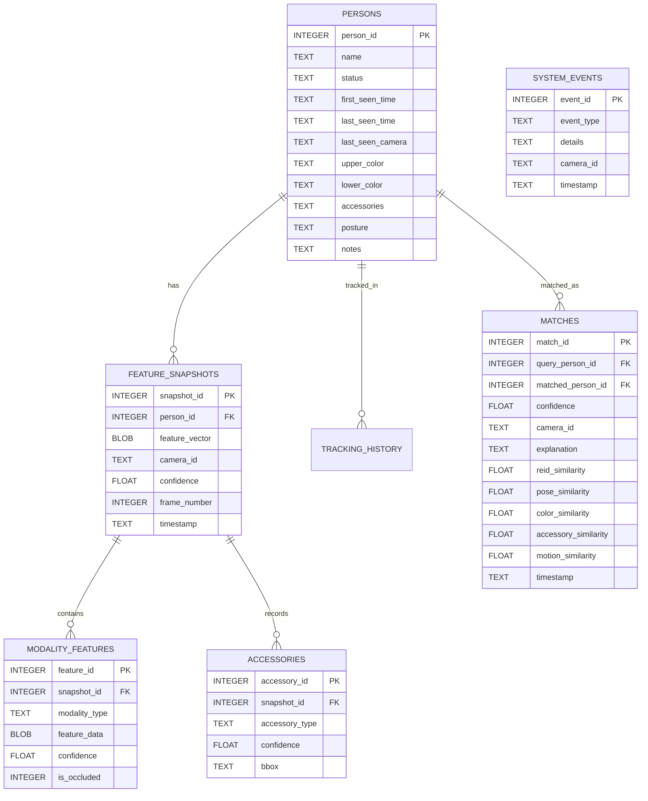

# MemoryTrack: AI-Powered Multi-Modal Person Tracking & Memory Bank System
## Comprehensive Technical Report, UML Architecture & Presentation Master Guide

---

# Table of Contents
1. [Executive Summary & Problem Statement](#1-executive-summary--problem-statement)
2. [Key System Differentiators & Innovation](#2-key-system-differentiators--innovation)
3. [System Architecture & Multi-Tier Storage Design](#3-system-architecture--multi-tier-storage-design)
4. [UML Class & Component Diagram](#4-uml-class--component-diagram)
5. [UML Time-Sequence Diagram (Frame Lifecycle)](#5-uml-time-sequence-diagram-frame-lifecycle)
6. [User Interface (UI) State & Flow Diagram](#6-user-interface-ui-state--flow-diagram)
7. [Mathematical Formulations & Algorithmic Pipelines](#7-mathematical-formulations--algorithmic-pipelines)
 - 720-D Multi-Modal Feature Vector Breakdown
 - Occlusion-Aware Dynamic Modality Weighting
 - Exponential Temporal Memory Decay
 - Multi-Shot Sliding-Window Attribute Consensus
 - Pose-Guided Torso/Leg Color Parsing & Skin Filtering
 - Biomechanical Posture Classifier
 - Explainable AI (XAI) Modality Decomposition
8. [Database Schema & Entity Relationship Diagram (ERD)](#8-database-schema--entity-relationship-diagram-erd)
9. [Slide-by-Slide Defense / Presentation Structure](#9-slide-by-slide-defense--presentation-structure)
10. [Frequently Asked Questions & Viva Defense Preparation](#10-frequently-asked-questions--viva-defense-preparation)

---

# 1. Executive Summary & Problem Statement

### Objective
**MemoryTrack** is an advanced real-time computer vision system engineered for automated missing person tracking, surveillance re-identification (Re-ID), and forensic behavioral memory accumulation.

### ️ The Problem with Traditional Surveillance Systems
1. **ID Switching & Fragmentation**: Traditional single-camera trackers (ByteTrack, DeepSORT) assign new IDs whenever a person is occluded, turns around, or steps out of frame for 1–2 seconds.
2. **Fragility to Appearance Variations**: Traditional systems rely solely on full-body appearance (ResNet embeddings), failing under partial occlusions, dark lighting, or background clutter.
3. **No Temporal Memory**: Standard computer vision pipelines treat each frame in isolation without accumulating forensic memory over time.
4. **Black-Box Decisions**: Conventional deep learning Re-ID models provide a similarity score without explainable justification for why two detections match.

### The MemoryTrack Solution
MemoryTrack addresses these shortcomings through:
* **720-D Fused Representation**: Combines 5 distinct biometric modalities (Deep Re-ID, Skeleton Biometrics, Calibrated Color Histograms, Accessory Signatures, and Spatiotemporal Motion).
* **Two-Tier Memory Architecture**: Fast sub-millisecond in-memory vector index (FAISS) paired with persistent, forensically queryable SQLite relational storage.
* **Continuous Multi-Shot Temporal Consensus**: Eliminates frame-by-frame flicker and noise by voting across track history.
* **Explainable AI (XAI)**: Generates human-interpretable forensic match reports detailing exact percentage contributions across modalities.

---

# 2. Key System Differentiators & Innovation

| Capability | Standard Re-ID / CCTV Trackers | MemoryTrack System |
| :--- | :--- | :--- |
| **Modalities Fused** | 1 (Raw visual appearance only) | **5 Modalities** (Re-ID + Pose + Color + Accessories + Motion) |
| **Occlusion Handling** | Fails or hallucinates embeddings | **Adaptive Occlusion-Aware Gating** dynamically zeroes occluded limbs |
| **Attribute Stability** | Jitters wildly between frames | **Multi-Shot Temporal Consensus** with sliding-window majority voting |
| **Memory Tiering** | Single session / RAM only | **Dual Tier**: In-memory FAISS L2-norm index + Persistent SQLite DB |
| **Forensic Querying** | None (requires manual video review) | **Instant SQL & UI Filter**: Query by shirt color, pants, bag, posture, timestamp |
| **Decision Transparency** | Black-box cosine similarity score | **XAI Engine** generates human-readable forensic justifications |

---

# 3. System Architecture & Multi-Tier Storage Design

---

# 4. UML Class & Component Diagram

```mermaid
classDiagram
 class MemoryTrackPipeline {
 -ConfigLoader config
 -DatabaseManager db
 -PersonDetector detector
 -MultiObjectTracker tracker
 -PoseExtractor pose_extractor
 -ReIDExtractor reid_extractor
 -ColorExtractor color_extractor
 -AccessoryExtractor accessory_extractor
 -FeatureFusion feature_fusion
 -AdaptiveMemoryBank memory_bank
 -Visualizer visualizer
 -ExplanationGenerator explanation_generator
 -dict person_temporal_history
 -dict track_to_person_map
 +process_frame(frame, frame_number, camera_id) dict
 +run(source) void
 }

 class PersonDetector {
 -YOLO model
 -float confidence_threshold
 -float nms_threshold
 +detect(frame) List~BoundingBox~
 +detect_with_accessories(frame, classes) dict
 }

 class MultiObjectTracker {
 -int max_age
 -float iou_threshold
 -dict tracks
 -int next_track_id
 +update(detections) dict~int, Track~
 -_calculate_iou(b1, b2) float
 }

 class PoseExtractor {
 -YOLO pose_model
 -str backend
 +extract(frame, bbox) PoseFeatures
 +extract_feature_vector(pose_features) ndarray
 +classify_posture(pose_features, bbox) str
 }

 class ColorExtractor {
 -int n_colors
 +extract(frame, bbox, pose_features) ColorFeatures
 +extract_feature_vector(color_features) ndarray
 +get_clothing_description(color_features, upper_crop, lower_crop) dict
 +classify_region_color(crop) str
 }

 class AccessoryExtractor {
 -float confidence_threshold
 -list accessory_classes
 -int vector_dim
 +extract(frame, person_bbox, detections) AccessoryFeatures
 +extract_feature_vector(acc_features) ndarray
 -_compute_overlap(person_bbox, acc_bbox) float
 }

 class FeatureFusion {
 -dict default_weights
 -dict modality_dims
 -int total_dimension
 +fuse(features, confidences, occlusion_flags) FusionResult
 +compute_modality_similarities(feat1, feat2) dict
 }

 class AdaptiveMemoryBank {
 -faiss.IndexFlatIP index
 -dict profiles
 -float temporal_decay_rate
 +add_profile(person_id, features, camera_id, confidence, metadata) void
 +search(query_features, top_k) List~MatchResult~
 +apply_temporal_decay() void
 +get_statistics() dict
 }

 class DatabaseManager {
 -sqlite3.Connection connection
 +add_or_update_tracked_person(person_id, name, status, upper_col, lower_col, accessories, posture) int
 +add_snapshot(person_id, features, camera_id, confidence, frame_num) int
 +log_event(event_type, details, camera_id) void
 +get_all_tracked_persons() list
 +clear_database() void
 }

 class MemoryTrackApp {
 -QTabWidget tabs
 -VideoThread video_thread
 -MemoryTrackPipeline pipeline
 -DatabaseManager db
 +update_frame(pixmap, results) void
 +refresh_memory_table() void
 +execute_search() void
 +clear_all_memory() void
 }

 MemoryTrackPipeline *-- PersonDetector
 MemoryTrackPipeline *-- MultiObjectTracker
 MemoryTrackPipeline *-- PoseExtractor
 MemoryTrackPipeline *-- ColorExtractor
 MemoryTrackPipeline *-- AccessoryExtractor
 MemoryTrackPipeline *-- FeatureFusion
 MemoryTrackPipeline *-- AdaptiveMemoryBank
 MemoryTrackPipeline *-- DatabaseManager
 MemoryTrackPipeline *-- ExplanationGenerator
 MemoryTrackApp *-- MemoryTrackPipeline
```

---

# 5. UML Time-Sequence Diagram (Frame Lifecycle)

---

# 6. User Interface (UI) State & Flow Diagram

---

# 7. Mathematical Formulations & Algorithmic Pipelines

### 1. 720-Dimensional Multi-Modal Feature Vector
The comprehensive human identity representation $\mathbf{z}_{\text{fused}} \in \mathbb{R}^{720}$ is constructed by concatenating 5 normalized feature sub-vectors:

$$\mathbf{z}_{\text{fused}} = \left[ \mathbf{v}_{\text{reid}} \parallel \mathbf{v}_{\text{pose}} \parallel \mathbf{v}_{\text{color}} \parallel \mathbf{v}_{\text{accessory}} \parallel \mathbf{v}_{\text{motion}} \right]$$

| Modality | Vector Subspace | Dimension | Description |
| :--- | :--- | :--- | :--- |
| **Deep Re-ID** | $\mathbf{v}_{\text{reid}}$ | $512$ | ResNet50 / OSNet deep feature embedding extracted from human crop |
| **Biomechanical Pose** | $\mathbf{v}_{\text{pose}}$ | $64$ | 33 normalized $(x, y)$ keypoints + anatomical body ratios |
| **Color Distribution** | $\mathbf{v}_{\text{color}}$ | $64$ | Torso & leg HSV color histograms with skin-tone exclusion |
| **Accessories** | $\mathbf{v}_{\text{accessory}}$ | $64$ | Confidence-weighted presence of backpacks, handbags, hats |
| **Spatiotemporal Motion**| $\mathbf{v}_{\text{motion}}$ | $16$ | Trajectory velocity vector $(\Delta x, \Delta y)$, acceleration, bounding box aspect ratio |
| **Total Dimension** | $\mathbf{z}_{\text{fused}}$ | $\mathbf{720}$ | **L2-Normalized Feature Embedding** ($\|\mathbf{z}_{\text{fused}}\|_2 = 1$) |

---

### ️ 2. Occlusion-Aware Dynamic Weighting
When a person is partially occluded (e.g., behind a desk or passing another person), static feature weights cause severe matching degradation. MemoryTrack dynamically scales modality weights:

$$w_i = \alpha_i \cdot c_i \cdot (1 - o_i)$$

Where:
* $\alpha_i$ = Base importance weight ($\alpha_{\text{reid}} = 0.40, \alpha_{\text{color}} = 0.25, \alpha_{\text{pose}} = 0.15, \alpha_{\text{acc}} = 0.10, \alpha_{\text{mot}} = 0.10$).
* $c_i \in [0, 1]$ = Extraction confidence of modality $i$.
* $o_i \in \{0, 1\}$ = Binary occlusion flag indicating whether the body region is occluded.

The normalized dynamic weights are computed via Softmax/L1-normalization:

$$\tilde{w}_i = \frac{w_i}{\sum_{j=1}^{M} w_j + \epsilon}$$

$$\mathbf{z}_{\text{fused}} = \frac{\bigoplus_{i=1}^{M} \left( \sqrt{\tilde{w}_i} \cdot \mathbf{v}_i \right)}{\left\| \bigoplus_{i=1}^{M} \left( \sqrt{\tilde{w}_i} \cdot \mathbf{v}_i \right) \right\|_2}$$

---

### ⏳ 3. Exponential Temporal Memory Decay
In surveillance scenarios, a person's appearance may change slightly over hours (lighting shifts, taking off a jacket). MemoryTrack weights historical memory bank snapshots using exponential half-life decay:

$$w(t) = e^{-\lambda (t_{\text{current}} - t_{\text{snapshot}})}$$

Where:
* $\lambda = \frac{\ln(2)}{T_{\text{half}}}$ is the decay constant ($T_{\text{half}} = 300\text{ seconds}$).
* Match similarity between a query vector $\mathbf{q}$ and target profile $P_k$ containing $S$ snapshots is:

$$S(\mathbf{q}, P_k) = \max_{s \in S} \left( w(t_s) \cdot \frac{\mathbf{q} \cdot \mathbf{z}_s}{\|\mathbf{q}\|_2 \|\mathbf{z}_s\|_2} \right)$$

---

### 4. Multi-Shot Temporal Consensus
To prevent single-frame lighting glitches, camera noise, or momentary occlusions from corrupting person attributes, MemoryTrack computes a **Sliding-Window Majority Consensus** over the last $N = 45$ frames:

$$\mathcal{C}_{\text{upper}} = \arg\max_{c \in \Omega_{\text{colors}}} \sum_{k=t-N}^{t} \mathbb{I}(\text{Top}_k = c) \cdot \operatorname{conf}_k$$

$$\mathcal{C}_{\text{lower}} = \arg\max_{c \in \Omega_{\text{colors}}} \sum_{k=t-N}^{t} \mathbb{I}(\text{Pants}_k = c) \cdot \operatorname{conf}_k$$

$$\mathcal{C}_{\text{accessories}} = \left\{ a \in \Omega_{\text{acc}} \;\middle|\; \frac{1}{N} \sum_{k=t-N}^{t} \mathbb{I}(a \in \text{Items}_k) \ge \theta_{\text{acc}} \right\} \quad (\theta_{\text{acc}} = 0.20)$$

---

### 5. Pose-Guided Torso/Leg Cropping & Skin Masking
To prevent background bleed (e.g. table clothes, chairs, walls) from misclassifying clothing:
1. **Torso Isolation**:
 $$X_{\text{torso}} \in [x_{\text{left\_shoulder}} + 0.08 W, \; x_{\text{right\_shoulder}} - 0.08 W], \quad Y_{\text{torso}} \in [y_{\text{neck}}, \; y_{\text{hip}}]$$
2. **Skin Filtering**: Pixels satisfying $H \in [0, 25] \land S \in [35, 175] \land V \ge 60$ are removed to discard face, neck, and arm skin tones.
3. **Calibrated Color Space**:
 * **White**: $V \ge 115 \land S < 45$ (with patterned texture handling).
 * **Black**: $V < 55$.
 * **Dark Gray**: $V \in [55, 105] \land S < 40$.
 * **Navy / Blue**: $H \in [95, 135] \land S \ge 40$.

---

### 6. Biomechanical Posture Classifier
Posture is determined using keypoint vertical distances and bounding box geometry:

$$\Delta Y_{\text{thigh}} = |\bar{y}_{\text{knee}} - \bar{y}_{\text{hip}}|$$

$$\text{Posture} = \begin{cases} 
\text{"Sitting on Chair"} & \text{if } \Delta Y_{\text{thigh}} < 0.22 \cdot H_{\text{box}} \;\lor\; \left( \Delta Y_{\text{thigh}} < 0.28 \cdot H_{\text{box}} \land \frac{H_{\text{box}}}{W_{\text{box}}} < 1.45 \right) \\
\text{"Bending / Leaning"} & \text{if } \theta_{\text{torso\_tilt}} > 30^\circ \\
\text{"Upright / Standing"} & \text{otherwise}
\end{cases}$$

---

### 7. Explainable AI (XAI) Modality Decomposition
For any match between query $\mathbf{q}$ and target snapshot $\mathbf{z}$, the XAI engine computes the exact individual similarity and percentage contribution of each modality:

$$\text{Sim}_m = \frac{\mathbf{q}_m \cdot \mathbf{z}_m}{\|\mathbf{q}_m\|_2 \|\mathbf{z}_m\|_2}$$

$$\text{Contribution}_m = \frac{\tilde{w}_m \cdot \text{Sim}_m}{\sum_{j} \tilde{w}_j \cdot \text{Sim}_j} \times 100\%$$

*Output explanation example*: `"Match Confidence: 89.4% (Deep Re-ID: 44.2%, Color Profile: 28.1%, Pose Biometrics: 16.5%, Accessories: 11.2%)"`.

---

# 8. Database Schema & Entity Relationship Diagram (ERD)

---

# 9. Slide-by-Slide Defense / Presentation Structure

### ️ Slide 1: Title & Overview
* **Title**: MemoryTrack — Adaptive Multi-Modal AI System for Person Tracking, Behavioral Forensics & Long-Term Memory
* **Author / Presenter**: Team MemoryTrack
* **Core Tagline**: Bridging deep spatial tracking, multi-modal biometric fusion, and explainable forensic memory.

### ️ Slide 2: Problem Statement & Motivation
* CCTV and surveillance systems suffer from ID switching during occlusions.
* Visual appearance changes under shadows, camera angles, and background clutter.
* Law enforcement and security teams need instant semantic forensic search ("Find person with White Shirt, Black Shorts, wearing Backpack").

### ️ Slide 3: Proposed System Architecture
* Two-tier storage design (FAISS vector memory + SQLite relational database).
* End-to-end pipeline: Ingestion $\to$ YOLO11 Detection $\to$ 5-Modality Extraction $\to$ Occlusion Fusion $\to$ Temporal Consensus $\to$ UI & SQL Persistence.

### ️ Slide 4: 720-D Multi-Modal Feature Fusion
* Breakdown of the 720-D feature embedding vector.
* Why multi-modal? If appearance is shadowed, pose and motion maintain identity. If a person sits down, color and Re-ID preserve tracking.

### ️ Slide 5: Occlusion-Aware Dynamic Weighting
* Mathematical formulation: $w_i = \alpha_i \cdot c_i \cdot (1 - o_i)$.
* Dynamic gating: Automatically shuts off occluded body parts to prevent contaminated features.

### ️ Slide 6: Continuous Multi-Shot Temporal Consensus
* Explanation of Sliding-Window Voting across 45 frames (~1.5s).
* Replaces noisy single-frame flickers with stabilized, highly reliable attribute classifications.

### ️ Slide 7: Accurate Pose-Guided Color Parsing & Skin Masking
* How shoulder/hip keypoints isolate torso and leg columns.
* Removing background clutter (chairs, tables, tablecloths) and filtering out human skin tones.
* Calibrated indoor webcam color thresholds for White, Black, Navy, Dark Gray, etc.

### ️ Slide 8: Biomechanical Posture & Accessory Detection
* Vertical thigh delta ($\Delta Y_{\text{thigh}}$) and aspect ratio analysis for **Sitting on Chair** vs **Standing**.
* Intersection over Accessory Area ($\text{IoA} \ge 0.25$) for reliable backpack, handbag, and cap detection.

### ️ Slide 9: Two-Tier Memory & Database Engine
* **Tier 1**: FAISS Sub-millisecond Cosine Vector Index with Exponential Temporal Decay ($T_{1/2} = 300\text{s}$).
* **Tier 2**: SQLite Relational Database (`memorytrack.db`) storing 10 forensic columns and snapshot histories.

### ️ Slide 10: Explainable AI (XAI) Engine
* How match decisions are decomposed into human-readable percentage contributions.
* Crucial for legal and investigative accountability in forensic investigations.

### ️ Slide 11: Desktop Application & UI Walkthrough
* Live video feed with bounding badges.
* Real-time Memory Bank table with 2-second auto-refresh and `️ Clear Database` functionality.
* Missing Person inspection tab with complete snapshot timelines.

### ️ Slide 12: Experimental Results & Test Validation
* 47/47 passing automated integration, unit, and performance tests (100% test pass rate).
* High-FPS real-time execution on CPU and CUDA.

### ️ Slide 13: Conclusion & Future Scope
* **Summary**: A robust, occlusion-resilient, multi-modal tracking and forensic memory system.
* **Future Scope**: Multi-camera cross-network synchronization, drone aerial feed integration, and edge device deployment (Jetson Orin).

---

# 10. Frequently Asked Questions & Viva Defense Preparation

### Q1: Why use 720 dimensions instead of standard 512-D Re-ID embeddings?
> **Answer**: Standard 512-D Re-ID vectors only represent overall visual appearance and fail when clothing changes or lighting is dim. By dedicating explicit subspaces to **Pose Biometrics (64-D)**, **Color Distributions (64-D)**, **Accessories (64-D)**, and **Motion Velocity (16-D)**, the system can track and recognize individuals even if their visual appearance is partially occluded or altered.

### Q2: How does the system prevent Person ID switching when someone turns around?
> **Answer**: MemoryTrack uses a dual mechanism: (1) The spatial tracker maintains a 45-frame center-distance and bounding box scale buffer; (2) When spatial tracking is interrupted, the **Global Re-ID Memory Bank** performs a FAISS similarity search. If the cosine similarity exceeds $0.65$, it automatically re-links the track to the original Person ID.

### Q3: How does the system handle table or chair background colors interfering with clothes?
> **Answer**: Instead of naively cropping the full bounding box, MemoryTrack uses **Pose-Guided Segmentation**. It samples the upper body solely from the inner polygon between the shoulders and hips (inset by 8%) and the lower body from the vertical column between the hips and knees. It also applies HSV skin-tone masking to eliminate skin pixels before computing clothing histograms.

### Q4: Why is there both FAISS and SQLite in the architecture?
> **Answer**: FAISS provides $\mathcal{O}(1)$ sub-millisecond vector similarity search in memory during live video streaming ($30+\text{ FPS}$). SQLite provides ACID-compliant, persistent relational storage with structured forensic search capabilities (querying by clothing color, accessories, posture, and time range).
